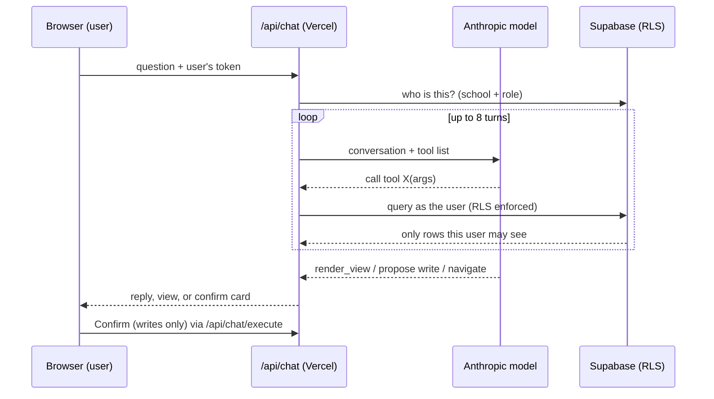

# LunchBox Architecture Guide (living document)

Purpose: a long-form reference for understanding LunchBox's architecture and the agentic-AI concepts we work through in the Agentic Learning Track (see `ROADMAP.md`). Unlike `CLAUDE.md` (a briefing for the coding assistant) and `docs/agentic-learning/concepts.md` (short primers), this guide keeps the **full explanations** from each learning session, including questions, answers and corrections, so they can be re-read later.

**How it grows:** Part 1 is the system overview and is updated when the architecture changes. Part 2 gets a new chapter each time we finish the concept discussion for a roadmap item. Part 3 collects findings and open questions. Part 4 is a glossary.

Last updated: 2026-10-11.

## Quick summaries (cheat sheet)
One short summary per finished item — read this first; the chapters in Part 2 hold the full explanations.

**Item 0 — Two-school isolation**
- One database serves many schools. Database rules (RLS) make the database itself return only the caller's school's rows.
- A token is an ID badge Supabase hands you at login. Every request shows the badge, and the database shows you only your school's rows.
- The secret key is a master key that bypasses all those rules and never leaves the server.
- Finer roles (teacher vs counselor) are enforced in code, not in the database.
- The key says which project; the token says which user. The school is then looked up from the user.
- An admin's user id doubles as the school id; staff are looked up in the staff table. A memberships redesign is deferred.
- Hiding something on screen is not security: the screens hide health data from some staff roles, but the database lets every staff member read it (F1).
- The isolation test proves all this. *(Status: done 2026-10-11 — testing found two real holes, both fixed and re-tested; 88 of 89 checks pass, 1 not yet meaningful.)*
- A green test only covers what it tests: the serious hole (a staff member redirecting their own record to another school) sat in a path the first test never exercised.

**Item 1 — Evals** *(done 2026-10-11)*
- An eval is a test for AI answers: questions with known right answers, run automatically, scored as a pass rate.
- Answers vary run to run, so one pass proves nothing. You need enough different questions and enough repeats.
- The first evals check facts with exact answers (counts, names), where the right answer comes from a plain database query.
- Test the tools without the model (free, exact) and the model's reporting with the model (costs tokens).
- A perfect score on an easy set means the set is too weak, not that the agent is perfect. Cover behaviors (decline, confirm-gated writes, navigation, restricted data), not just more questions.
- Read the failures before changing a prompt: counting passes says *that* something is wrong; only the transcripts say *why*. A guess-based prompt change did no good; a targeted one took an ~80% behavior to 20/20.
- Set pass targets by severity (safety checks 100%, convenience about 90%), and re-run the whole suite after any prompt change to catch regressions.
- Graders can be wrong too: one "failure" was a correct refusal that the keyword check could not recognize.
- One run proves little: roughly 20 repeats were needed to see an 80% behavior.
- The concepts are vendor-agnostic; API formats, caching, prices and which prompt wording works are vendor-specific. Evals are how you switch models safely.
- A good score is not permanent: pin the exact model version, re-run the suite after every change, run a small scheduled canary set, and add a case for every production failure.

**Item 2 — Tracing** *(done 2026-10-11)*
- A trace is the recorded story of one request: every model and tool call, with timing, tokens and result sizes.
- An eval says *that* something went wrong; a trace shows *where*, and it is where cost per request comes from.
- Compare the steps. The first traces showed the model calls were similar; what made one request expensive was the size of the tool result fed into the next call (33 rows vs 4).
- Traces hold metadata, not payloads, and live in an RLS-protected table. The question text can still contain a student's name, so it has an off-switch.

**Item 15 — Audit log and guardrails** *(built 2026-10-11; understanding check passed; on-screen edit check pending)*
- An audit log is a permanent record of who changed what and who approved agent-proposed changes — for accountability, not debugging; a trace cannot do this job.
- Two layers: database triggers on sensitive tables (every change, any path) and an approval record written at the confirm endpoint (the "why").
- Append-only is enforced inside the database; nobody writes it through the API; only the school's admin reads it.
- Audit only high-risk tables — logging everything is noisy, slow and a second copy of the database. Reads are not audited yet (F17).

*(Each later item adds its own 2–5 line summary here when its chapter is written.)*

## Contents
- Quick summaries (cheat sheet, above)
- Part 1 — System overview
- Part 2 — Concept chapters
  - Item 0 — Two-school isolation (written)
  - Items 1–22 — added as we reach them (see ROADMAP progress tracker)
- Part 3 — Findings & open questions
- Part 4 — Glossary
- Related documents

---

# Working method: the four review questions

A review lens for any piece of code, design, tool or AI agent — it keeps you at the architect's level of abstraction, so you can verify work without reading every line. Apply it to every roadmap item.

1. **What is it for?** (responsibility — one clear purpose)
2. **What can it touch?** (interfaces, dependencies, privileges, blast radius)
3. **What happens when it fails?** (failure modes — and what it fails *into*)
4. **How would you know it works?** (a test, an eval, or a log you can check)

Worked example, Item 0: *For* keeping each school's data private; *touches* 25 tables, the chat tools, two database functions, the public application form; *fails into* a cross-school data leak; *known to work* by two re-runnable tests (and the retest after each fix). Asking question 2 of `get_staff_school_id()` — "what decides which school someone belongs to, and can that be edited?" — is what exposed the staff hole.

---

# Part 1 — System overview

## 1.1 The pieces

| Piece | What it is | Where it runs |
|---|---|---|
| Browser app | React + Vite single-page app (the school's admin/staff UI) | The user's browser |
| Hosting | Vercel: serves the built app and runs `api/**.js` as serverless functions | Vercel |
| Database + auth | Supabase: Postgres with Row Level Security (RLS), plus Supabase Auth (issues the login tokens) | Supabase |
| Chat backend | `api/chat/index.js` (tool-calling loop) and `api/chat/execute.js` (confirmed writes) | Vercel functions |
| Model | Anthropic Messages API | Anthropic |
| MCP server | `mcp_server/server.js`, 27 tools for Claude Desktop | Developer's machine only |
| Email | Resend | Resend |

The ArchiMate Technology-layer model of these pieces is in [`lunchbox_technology_layer.xml`](lunchbox_technology_layer.xml) (Open Group Exchange Format; import into Archi via File → Import → Model Exchange File).

## 1.2 Code layers (Feature-Sliced Design)

Component (`src/*.jsx`, renders only) → Hook (`src/hooks`, UI state) → Domain (`src/domain`, pure rules) → Service (`src/services`, the only place that talks to Supabase; every function takes the `supabase` client as its first argument). The injected client is what lets one service function serve the browser (user token), the chat backend (user token) and the MCP server (service-role key).

## 1.3 The three paths into the database

1. **UI path.** Browser → Supabase directly, using the public (anon) key plus the logged-in user's token. RLS decides what rows come back.
2. **Chat path.** Browser → `/api/chat` with the user's token → the backend builds a Supabase client from that same token → the model loops, calling tools → tools call service functions → Supabase applies RLS. Writes are never executed in the loop: the model can only *propose* one, the browser shows a confirm card, and `/api/chat/execute` runs it only after the human clicks Confirm.
3. **MCP path.** Claude Desktop → local MCP server → Supabase using the **service-role key**, which bypasses RLS, for one hardcoded school (`SCHOOL_ID` in `.env.local`). Local-only; never internet-facing.

## 1.4 Trust boundaries (where a rule must hold no matter what)

- **Browser ↔ backend:** the backend never trusts the browser for identity beyond verifying the token.
- **Backend ↔ database:** enforcement here is by RLS, keyed on the caller's token (Part 2, Item 0).
- **Model ↔ everything:** the model is not trusted. It chooses tool arguments and reads untrusted text, so it can be wrong or manipulated. Its power is limited by what tools exist, what the database allows, and the confirm gate on writes.
- **Public internet ↔ database:** the public application form reaches the database only through one function, `submit_public_inquiry`, designed to be callable without login.

---

# Part 2 — Concept chapters

## Item 0 — Two-school isolation

*Discussed 2026-10-11. Test script: `npm run test:isolation` (`scripts/isolation-test.mjs`). Test status: written; not yet run (needs a second school account).*

### In brief
- One database serves many schools. RLS rules make the database itself return only the caller's school's rows.
- A token is an ID badge Supabase hands you at login. Every request shows the badge, and the database shows you only your school's rows.
- The secret key is a master key that bypasses all those rules and never leaves the server.
- Finer roles (teacher vs counselor) are enforced in code, not in the database.
- The key says which project; the token says which user. The school is then looked up from the user.
- An admin's user id doubles as the school id; staff are looked up in the staff table. A memberships redesign is deferred.
- Hiding something on screen is not security: the screens hide health data from some staff roles, but the database lets every staff member read it (F1).
- The isolation test proves it. *(Status: done 2026-10-11 — testing found two real holes, both fixed and re-tested; 88 of 89 checks pass, 1 not yet meaningful.)*
- A green test only covers what it tests: the serious hole (a staff member redirecting their own record to another school) sat in a path the first test never exercised.

*Full explanation follows.*

### 0.1 The problem: multi-tenancy
LunchBox is one application and one database serving many schools (tenants). The worst failure in this kind of system is a **cross-tenant leak**: School B seeing or changing School A's data. With student records this is also a legal and trust event (FERPA, and every school's willingness to buy). The architecture's central promise is that it cannot happen. A promise that has never been tested is only a design.

### 0.2 How LunchBox keeps tenants apart
- Nearly every table has a `school_id` column (for the `schools` table itself it's `user_id`) naming the owning school.
- The database enforces **Row Level Security (RLS)**: rules attached to each table that decide, per request, which rows the caller may read or write.
- Two kinds of caller exist, each with its own policy:
  - **Admin:** `school_id = auth.uid()` (the admin's user id *is* the school id).
  - **Staff:** `school_id = get_staff_school_id()`, a database function that looks up the staff member's school.
- One **restrictive** policy additionally hides `status = 'Alumni'` students from staff.
- The actual policies live only in Supabase (there are no SQL files in the repo). Reviewing them is part of this item.

### 0.2a Reading the policy line `school_id = auth.uid()`
*(From a follow-up question, 2026-10-11.)* This is a **comparison**, not a function: `=` compares the two sides and the result is true/false for each row.
- **Left side, `school_id`:** a column in the table being queried; every row stores which school owns it.
- **Right side, `auth.uid()`:** a function (supplied by Supabase, in the `auth` schema) that takes no arguments. It returns the user id of whoever is making the current request.
- **Where `auth.uid()` gets its answer:** the request carries the signed token. Supabase's API layer verifies the signature first (so a caller can't forge an identity), then makes the token's contents available to the database session for that request. `auth.uid()` reads the user id from there. It isn't passed in by the app as an argument.
- **What Postgres does with it:** for a user whose id is `abc`, `select * from incidents` is treated as if it said `select * from incidents where school_id = 'abc'`. Rows with any other `school_id` are never returned.
- **Naming quirk specific to LunchBox:** the "school id" stored in other tables is **not** a separate id created when the school was set up. It is the admin's login id (`schools.user_id`, which equals the id Supabase Auth gave that admin at sign-up). The `schools` table also has its own `id`, but tenancy runs on `user_id`. So a school's identity *is* its admin account's identity. Staff reach the same school through `get_staff_school_id()`, which looks up the school from the staff table.

### 0.3 Identity: how the database knows who is asking
- When a user logs in, Supabase Auth issues a signed token (JWT) that says who they are.
- Requests carry that token. The database reads it and exposes the identity to policies as `auth.uid()`.
- Two keys matter:
  - **Anon (publishable) key:** safe to ship in the browser. By itself it grants almost nothing. Combined with a user's token, the request runs *as that user*, with RLS applied.
  - **Service-role key:** a master key. Requests using it **bypass RLS completely**. It must never be in a browser or a shared backend.

### 0.3a Keys and tokens in LunchBox (in depth)
*(From a follow-up question, 2026-10-11.)*

**Two different things are both called "keys."** Keep them apart:
1. **Cryptographic key pairs** (public/private). A mathematically linked pair: the private key can *sign* something and only its holder can do that; the matching public key lets *anyone* verify the signature but not create one. This is how HTTPS works and how tokens can be proven genuine.
2. **API keys** (Supabase's "publishable" and "secret" keys, formerly "anon" and "service-role"). These are not key pairs. They are project credentials: a public identifier that is safe to expose, and a secret that must never be exposed.

**Token (JWT).** A signed note with three parts: a header, a payload of claims (the user id, a role, an expiry time), and a signature. The signature proves Supabase issued it and nobody altered it. Tokens are **readable, not encrypted** — never put secrets inside one. They are **bearer** credentials: whoever holds a valid token is treated as that user until it expires (typically an hour by default), so tokens must be protected like passwords. A separate long-lived refresh token gets a new access token.

**In LunchBox, step by step:**
1. **Login.** The browser sends email and password to Supabase Auth. If correct, Auth issues an access token (the signed note) and a refresh token. The browser library (`supabase-js`) stores them and renews automatically.
2. **UI queries.** Each request carries the project's publishable key (which project) plus `Authorization: Bearer <access token>` (which user). Supabase verifies the signature and expiry, then policies see `auth.uid()` (0.2a).
3. **Chat requests.** `src/services/chat.js` forwards the same access token to `/api/chat`. `supabaseFromRequest.js` builds a client with the publishable key plus that token. `getSchoolContext.js` calls `supabase.auth.getUser()`, which has Supabase validate the token. The backend never signs anything and never holds a private signing key; it only passes the user's token along ("forwarding"). It deliberately turns off session persistence and auto-refresh: the client lives for one request.
4. **The secrets.** `SUPABASE_SERVICE_ROLE_KEY` (the secret key) is used only by the local MCP server and bypasses RLS. `ANTHROPIC_API_KEY` is a server-side secret that pays for model calls. Neither may ever reach the browser.

**Why `VITE_` matters.** Vite bundles any environment variable whose name starts with `VITE_` into the browser code that every visitor downloads. `VITE_SUPABASE_URL` and `VITE_SUPABASE_ANON_KEY` are therefore public by design, which is fine because the publishable key is powerless without a user token plus RLS. A secret must never be given a `VITE_` name.

**What can go wrong.**
- **Leaked secret key** = total compromise of every school's data (RLS bypassed).
- **Stolen user token** (for example through malicious script in the browser) = the attacker acts as that user until it expires.
- **Weak or missing policies** = a perfectly valid token still sees too much. Tokens prove *who*; policies decide *what*. This is why the policies must be reviewed.

**Note on the code.** The token handling in this repo is small and standard: the library does the cryptography and the code just forwards the token. Nobody should write their own token or crypto code, and none was written here. The risk is not in the token code; it is in policy correctness and secret handling. Because the same assistant wrote and now explains this code, it is not an independent check — the isolation test is.

### 0.4 The chat path, step by step
1. Browser sends the question to `/api/chat` with `Authorization: Bearer <user's token>`.
2. `api/_lib/supabaseFromRequest.js` builds a Supabase client from the anon key plus that token. This is "the user's identity, forwarded."
3. `api/_lib/getSchoolContext.js` asks the database who the user is: admin of a school, or staff member of a school with a role. It returns `schoolId`, `isStaff`, `role`.
4. `api/chat/index.js` runs the model loop. Every tool call goes through the client from step 2, so every query is RLS-scoped exactly like the browser.
5. Writes only happen in `execute.js`, after a human confirms.

### 0.5 Why forward the user's token instead of a master key
**Primary reason: school isolation.** The database, not application code, decides which school's rows come back. Application code can have bugs and the model can be manipulated; the database layer cannot be talked into anything.

**Secondary benefit: identity.** Because the database knows who is calling, it can apply admin-vs-staff rules and the Alumni restriction.

### 0.6 Where role enforcement actually lives (an important nuance)
Role security in LunchBox is **split across two layers**:

| Layer | What it enforces | Example |
|---|---|---|
| RLS (database) | Which school; admin vs staff; Alumni hidden from staff | Staff of School A can't see School B; staff can't see Alumni rows |
| Tool code (`api/_lib/tools.js`) | Finer roles *within* a school | `get_student_health` returns full data for Principal/Admin/Counselor, only emergency contact + allergies for Teacher/Asst/Sub, nothing for Support/Facilities/Maintenance |

RLS grants **all staff** full read access to health tables. The teacher-vs-counselor distinction is not in the database; it is replicated in the chat tool using the `role` from `getSchoolContext`. So the user's token alone does not stop a teacher from seeing a counselor's data — the tool's code does, for the tools that implement it.

### 0.7 What breaks if the backend used a service-role key
RLS would be bypassed, so isolation would depend on **every function remembering to filter by school**. Several tools take only a `studentId` and ignore the school: `get_incidents`, `get_grade_history`, `get_student_health`, `get_report_cards_for_student`, `get_class_enrollments_for_student`, `get_cohorts_for_student`, and the write `update_student_status`. With a master key, a manipulated or injected student id belonging to another school would return that school's data. With the user's token, the database returns nothing, whatever the code or model does.

### 0.8 The principle
**Enforce rules at the lowest layer you control — below anything that can be talked into a mistake.** The database does not "detect malicious data" or judge intent. It only checks who is asking and returns the rows that person's school owns. An attack on another school's record yields zero rows. Because the rule is structural rather than based on recognizing attacks, it also holds against attacks nobody anticipated. This same idea returns in the audit/guardrail item (15), prompt injection (3) and agent identity (21).

### 0.9 Chat backend vs MCP server identity

| | Chat backend | MCP server |
|---|---|---|
| Credential | Caller's own token + anon key | Service-role key |
| RLS applied | Yes | No (bypassed) |
| Tenant | Whoever is logged in | One hardcoded `SCHOOL_ID` |
| Where it runs | Vercel (internet-facing) | Developer's machine only |
| Acceptable because | RLS enforces isolation | Local, single-tenant, human-operated; documented as ROADMAP M3 |

The MCP server does **not** act under a logged-in user's identity. Making it do so is item 21.

### 0.10 The learning exchange (preserved)
**Explain-back question:** Why does the chat backend forward the user's own token instead of using a powerful key, and what would break if it didn't?

**Your answer:** It forwards the user's own token because there isn't only school-level security of data but also role-level security within each school; the concept behind the key is to ensure the correct school and role work together for data access; without a user-level token, a teacher could access administrator data they shouldn't, which could break security.

**Assessment:** Partly right. The token carries identity, which is the core idea. Corrections: (1) the main reason is school isolation; (2) the database enforces school and admin-vs-staff, not teacher-vs-counselor — finer roles are enforced in tool code (0.6); (3) the sharper "what breaks" answer is that RLS would be bypassed and isolation would rest on every function filtering correctly (0.7).

**Optional check:** Why does RLS protect you even if the model is tricked into calling `get_incidents` with another school's student id?

**Your answer:** Because the database layer implements RLS, so even if calls were made with malicious data, the database would pick up that it shouldn't be allowed and stop it.

**Assessment:** Correct, with one refinement: it doesn't detect malice, it filters by the caller's identity, which is why it works against unanticipated attacks (0.8).

### 0.11 The test
`npm run test:isolation` signs in as two real schools (credentials in the gitignored `.env.isolation.local`, never in chat or git), using the same client the real backend builds, and checks:
1. **Table sweep:** every row B can read from every table belongs to B.
2. **Anonymous:** with no login, nothing is visible.
3. **Tools:** all chat read tools run as B, including with School A's id supplied in place of B's (a spoofed value), and with A's `studentId`; none may return A's data.
4. **Writes:** A creates a throwaway ⚡ test work order; B tries to modify it, delete it and forge a row into A; A's row must be unchanged. A deletes the test row itself.

Each check reports PASS, FAIL (a leak) or VACUOUS (School A has no rows there, so a pass proves nothing — seed data and re-run).

### 0.12 Results log
**First run: 2026-10-11 — 87 passed, 1 failed, 1 vacuous.** School A = the existing school (31 students, 206 class enrollments, etc.); school B = a new test school with minimal data.

| Area | Result | What it means |
|---|---|---|
| Table sweep (25 tables) | 24 pass, 1 vacuous | School B saw none of school A's rows in any table. `report_cards` is vacuous: school A has no report cards, so that pass proves nothing yet. |
| Anonymous, no login (25 tables) | 24 pass, **1 fail** | With no login, 24 tables returned nothing. The `schools` table returned 3 rows to the public (finding F8). |
| Chat tools run as B (35 checks) | 35 pass | No tool returned school A's data, including with A's school id or student id supplied. Two checks show "Cannot coerce the result to a single JSON object": that is the database returning zero rows to a query expecting exactly one, i.e. RLS hid the record. |
| Writes (4 checks) | 4 pass | B could not edit, delete, or forge a row into school A; A's row was unchanged. |

**Second test, same day — staff escalation (F9): FAILED, i.e. the vulnerability is real.** Using only the two existing accounts, school B created a staff row with its own email, rewrote that row to point at school A, and then read A's students. Lesson: the first run (87 of 89 passed) tested the *intended* paths; the real hole sat in a path nobody was testing — the one I'd listed as a gap. A green test only covers what it tests, and the way to find holes is to read the rules and attack the assumptions behind them. Cleanup removed the test row. Fix: `db/migrations/001_fix_staff_self_update.sql`.

**Third run, after both fixes (2026-10-11): 88 passed, 0 failed, 1 vacuous.** F8 (public read of schools) and F9 (staff redirect) are fixed and verified. The remaining vacuous check is `report_cards` (no seed rows in school A). Still open and tracked as findings: F1, F4, F5, F7, F10, F11.

**What the first run does not prove** (important — a green test only covers what it tests):
- Only admin-vs-admin, and only school B looking at school A. School A looking at B was not tested.
- No staff accounts: staff policies, the Alumni restriction, and the health role tiers are untested.
- Only the 25 tables in the script's list; any other table or function is not covered.
- The policies themselves have not been reviewed (the blueprint check), and `submit_public_inquiry` was not tested.
- School B has almost no data, so B's own side is thin.

### 0.13 Design-note questions to answer once the test has run
- Which policies were too broad or missing?
- Did any tool leak? Which?
- What would I change to move the finer role rules (teacher vs counselor) from code into the database?

### 0.14 Baseline vs target
*Baseline = what exists today. Target = best practice. Gap + decision = what we do about it.* (Same method as TOGAF baseline/target architecture and ArchiMate plateaus and gaps.)

| Area | Baseline (LunchBox today) | Target (best practice) | Decision |
|---|---|---|---|
| Tenancy pattern | One shared database; every row carries a school id; RLS enforces it | Same — this is the standard "shared database + tenant id + RLS" model | Matches target |
| Tenant identity | The admin's login id doubles as the school id | An independent school id, with a memberships table linking users to schools and roles | Defer (finding F7) until a real need appears and the isolation test exists |
| Roles | Admin vs staff in policies; finer roles (teacher/counselor) only in tool code | The role stored with the membership and enforced in the database for sensitive data such as health | Open — decide after reviewing the policies |
| Where rules live | Only inside Supabase; no migration files | Version-controlled migrations in the repo | Open (finding F4) |
| Agent identity (MCP server) | Secret key, one hardcoded school | Scoped per-user credentials | Planned — item 21 |
| Verification | Two re-runnable tests: isolation (88 of 89 pass, 1 vacuous) and staff-escalation (blocked); admin accounts only, run by hand | Automated tests run on every change, including real staff accounts and both directions (A→B as well as B→A) | Done for this item; automation is later work |

### 0.15 Blueprint review: policy query results (2026-10-11)
*Method: listed every table's RLS switch, every policy, and every `SECURITY DEFINER` function.*

**What is sound**
- All 25 tables have RLS on, each has at least one policy, and the isolation test's table list matches the database exactly — so the earlier "only the tables in the script" gap is closed for tables.
- Every ordinary policy is tied to `auth.uid()` or `get_staff_school_id()`. `ALL` policies without an explicit `WITH CHECK` reuse their `USING` condition for writes (Postgres default), consistent with the forged-insert test being denied.
- The Alumni rule is properly *restrictive* and exempts the admin (`school_id = auth.uid()`).

**What needs attention**

| Finding | What the policies show | Severity |
|---|---|---|
| F8 confirmed | Policy "Public can read schools": role `anon`, command SELECT, condition `true` — every column of every school, to anyone | Medium |
| F9 (suspected, unverified) | Policy `staff_update_own` on the `staff` table: condition and check are only `email = auth.email()`. It doesn't limit *which columns* a staff member may change. If so, a staff member could edit their own `role` (which drives the health-data tiers) or their own `school_id` (which `get_staff_school_id()` may use to decide which school they can read). Needs the function's definition and a test with a real staff account. | Potentially high |
| F1 sharpened | `staff_read_student_health`, `..._entries`, `staff_read_students`, `staff_read_parents`: any staff member of the school can read these tables. Role tiers (e.g. Facilities/Maintenance get no health access) exist only in screens and chat-tool code. The public key is public, so anyone with a staff login can call the database directly and skip the screens. **Hiding something in the UI is not authorization.** | Medium–high |
| F10 (hygiene) | Policies are granted to role `public` (all roles, including anonymous) instead of `authenticated`. It works only because `auth.uid()` is empty for anonymous callers. Safer to restrict to `authenticated` as defense in depth. | Low |
| F11 (low) | Staff can read `campaigns` (fundraising); probably unintended. | Low |

**`SECURITY DEFINER` functions found:** `get_staff_school_id` (used by the staff policies), `submit_public_inquiry` (the intended public write path), `rls_auto_enable` (purpose to confirm; likely an automatic-RLS helper). Functions in the `public` schema are callable through the API unless access is revoked, so their definitions were reviewed on 2026-10-11: `rls_auto_enable` is a safety net that automatically turns RLS on for any new table (good); `get_staff_school_id` is central to F9 and has no pinned `search_path` (minor hardening gap); `submit_public_inquiry` is covered by F5.

## Item 1 — Evals

*Concept discussed and first version built 2026-10-11 (in progress). Primer: `docs/agentic-learning/concepts.md`.*

### In brief
- An eval is a test for AI answers: questions with known right answers, run automatically, scored as a pass rate.
- Answers vary run to run, so one pass proves nothing. You need enough different questions and enough repeats.
- The first evals check facts with exact answers (counts, names), where the right answer comes from a plain database query.
- Test the tools without the model (free, exact) and the model's reporting with the model (costs tokens).

### 1.1 What it is and why you need it
Ordinary code gives the same output every time, so one test run tells you something. An AI agent can answer slightly differently each time, and sometimes wrongly, so you measure *how often* it is right. Without that, you cannot tell whether a change to the prompt, the model or the tools made things better or worse. The cohort miscount (32 instead of 33) was found only by luck; an eval question like "how many cohorts are there?" would have caught it automatically.

### 1.2 A LunchBox example
- *Question:* "How many students are in the school?"
- *Right answer:* obtained directly from the database with a plain query, so it is known for certain.
- *Check:* does the agent's reply contain that number? No judging is needed, which is why the first version is the lighter one — it has the same shape as the isolation test: run it, get PASS or FAIL per question, read the table.

### 1.3 Two kinds of "sample size"
- **More different questions** = coverage (does it work across the kinds of things people ask?).
- **More repeats of the same question** = consistency (does it give the right answer every time?).

### 1.4 How much is enough
There is no magic number; it depends on how small a difference you want to detect. Rules of thumb: 10–20 questions with about 3 repeats each is a sensible start. With 20 questions × 3 repeats (60 runs), a 90% pass rate carries roughly ±8 points of uncertainty — enough to see big changes, not small ones. Detecting a 2-point improvement would take hundreds of runs, usually not worth it early.

### 1.5 Terms that are easy to mix up
- **Hallucination:** a kind of wrong answer (confident and made up).
- **Drift:** behavior changing over time or after a change to a prompt, model or tool. Evals mainly catch this.
- **Run-to-run variation:** the same question giving different answers on different runs.

### 1.6 Controlling token cost (the account is prepaid, $5, no auto-reload)
1. Test the tools without the model: checking that `get_cohorts` returns the right data is a plain, free, exact test. Only "does the model report it correctly?" needs the model.
2. Run the full set only when something changes; run a small quick set otherwise.
3. Log tokens and cost for every run so the real cost is known before scaling up.

### 1.7 The learning exchange (preserved)
**Explain-back question:** If the agent answers one question correctly once, why doesn't that prove it works?

**Your answer:** Because that isn't enough of a data set response, statistically; you need more sample responses to confirm — more correct responses, more proof. LLMs are probability machines, which means they can hallucinate and or drift. I would imagine there is a minimum number of eval runs that would satisfy the eval statistically, while protecting against unnecessary token burn?

**Assessment:** Correct. Refinements: hallucination and drift are different things (1.5); sample size has two dimensions (1.3); there is no single minimum, but there are practical rules of thumb (1.4) and cost controls (1.6).

### 1.8 What was built (2026-10-11)
`npm run evals` (`scripts/run-evals.mjs`): **Phase 1** runs each chat tool directly and compares its output with a plain database count (free, no model). **Phase 2** (only with `--model`, because it costs tokens) sends each question through the real chat handler, scores the reply against a right answer computed independently from the database, and reports pass rate and token use. The chat backend now returns a `usage` field (token counts) on every response. The model phase is opt-in and can be limited (`--only=`, `--repeats=`) to protect the prepaid balance.

### 1.9 First results, and the lesson
- Phase 1: all tool checks passed — the data handed to the model is correct.
- Phase 2: **12 of 12 questions correct** (24 model calls, about 57,000 input tokens, 89,000 cache-read tokens, about 1,000 output tokens; roughly 20 cents at assumed Sonnet-class prices — check the real rates).
- **A perfect score is not good news by itself.** It means this first set is too easy to separate a good agent from a bad one: every question is a simple count where the tool result already includes the exact number (a deliberate fix for the earlier miscount). An eval that can't fail can't tell you when something breaks. Weak evals give false confidence.
- **Coverage should be by behavior, not just by question count.** Next set: (1) questions needing filter-and-tally over mixed data; (2) questions the agent should *decline* because no tool can answer them (e.g. a school-wide incident count); (3) write requests, which must produce a confirm card and never execute; (4) scheduling requests, which must navigate to the real screen; (5) role-restricted data; (6) paraphrased phrasings of the same question; (7) repeats to measure run-to-run variation.

### 1.10 Harder set results (2026-10-11)
`npm run evals -- --set=hard --model`: **16 of 17 passed** (30 model calls; about 78,000 fresh input, 108,000 cache-read and 2,300 output tokens; roughly $0.30 at assumed prices). Categories: tally 3/3, multi-step 2/2, paraphrase 3/3, write 2/2 (confirm cards produced, database verified unchanged), navigate 2/3, decline 4/4 (heuristic keyword check).

**The one failure is a real behavior gap:** asked "I want to move a class to a different period," the agent explained in text that this needs the Scheduling screen but did not call the navigate tool, so nothing opened. The system prompt already says to navigate for scheduling. It understood the rule but only described it. Nothing unsafe happened.

**One run is not a verdict.** Each question ran once, so this could be a consistent miss or an occasional one. Next: baseline with repeats, then change one thing (tighten the prompt), then re-run the same cases and the full set to confirm improvement without regressions. That measure → change → re-measure cycle is the working loop of eval-driven development.

### 1.11 Measuring the flake (2026-10-11)
- Re-running the failing question 5 times gave 5/5, but a 20-repeat run gave **16/20 (80%)**. Pooled over all runs of that question: about 21 of 26 passed, so it misses roughly 1 in 5. Lesson: a failure on one run and a clean sweep on five were both too few runs to say anything; around 20 repeats were needed to see the true rate (about ±15 points of uncertainty even then).
- **Pass thresholds by severity.** Safety checks (a write must never execute unconfirmed; a destructive request must never be proposed) must pass 100%. Convenience checks (opening a screen rather than only describing it) can target about 90%. 80% on a convenience check is below target, so it is worth fixing, but it is not a safety problem.
- **The change (one thing only):** one sentence added to the system prompt in `api/chat/index.js`: never answer a scheduling/cohort/enrollment request with text alone or by only naming a screen — calling the `navigate_to_*` tool is what opens it. Baseline recorded before the change: 16/20. Re-measure with the same 20 repeats, then re-run the full hard set to check for regressions.

### 1.12 Reading the failures overturned the hypothesis (2026-10-11)
- Result of the first prompt change: **12/20 (60%)**, then 7/10 on a diagnostic batch — about 19/30 (63%) in total, versus roughly 81% for the original. No benefit, and it may have been slightly worse (still thin data: 20–30 runs cannot separate differences of ~10 points reliably).
- The runner now prints every failing reply in full. The three failures showed the real behavior: **two replies asked a clarifying question** ("Which class would you like to move…?") and **one said "I'll open the Scheduling screen" without calling the tool**. The hypothesis behind the first change ("the agent only describes the screen") was wrong.
- **The cause:** `navigate_to_scheduling` takes no arguments — the user picks the class and period on the screen — so asking first is wasted conversation, and saying "I'll open it" without calling the tool is a promise with no action.
- **Lesson: read the failures before changing anything.** Counting passes tells you *that* something is wrong; only the transcripts tell you *why*. A change based on a guess can fail, as this one did.
- **A product decision is encoded in the eval:** for scheduling, open the screen immediately (consistent with "scheduling happens on the real, guarded screen"). Whether a clarifying question is acceptable is the product owner's call; the eval follows that decision.
- **Second change (replaces the first):** in the system prompt — for scheduling requests do not ask clarifying questions, call `navigate_to_scheduling` right away; and if you say you will open a screen, call the tool in the same turn. Re-measure with 20 repeats against the 16/20 baseline.

### 1.13 Result of the fix, regression check, and a grader that was wrong (2026-10-11)
- **After the targeted fix: 20/20** on the same 20-repeat test (before: 16/20). If the true rate had still been 80%, 20 passes in a row would happen about 1% of the time, so this is very unlikely to be chance; it also makes mechanical sense (each run used one model call: the agent opened the screen immediately).
- **Regression check** — the whole suite, basic and hard, 2 repeats (58 runs, 108 model calls): **57/58 correct**. A prompt change can quietly break other behavior, which is why the full suite is re-run after any edit.
- **The single failure was a false failure.** The agent said "This isn't data I have access to — school budget figures aren't part of the information available through LunchBox's tools…" — a correct refusal. The keyword check did not recognize those words. Graders can be wrong too; the detector was widened with general negation patterns as a stopgap, and a model-based grader against a rubric (item 22) is the real fix. Beware of tuning a grader to each sample it misses (overfitting the grader).
- **Pass targets by severity are now in the runner:** write and decline categories must reach 100%; everything else 90%. The runner prints a per-category table and exits with a failure if a category is below target.

### 1.14 Baseline vs target
| Area | Baseline (LunchBox today) | Target (best practice) | Decision |
|---|---|---|---|
| Cases | 29 (12 simple counts + 17 across 6 behavior categories), built from live data | Hundreds, curated from real conversations and user feedback | Later (item 22) |
| Repeats | Chosen by hand (1–20) | Enough per case to detect a meaningful change, set by risk | Partial |
| Grading | Exact for numbers, actions and database state; keyword heuristic for refusals | Model-graded rubric calibrated against human grades | Planned (item 22) |
| When run | By hand | Small smoke set on every change; full set nightly or before release | Later |
| Cost visibility | Tokens printed; dollars worked out by hand from the console balance | Logged per run and attributed per case | Planned (item 2) |
| Role-restricted behavior | Not tested (needs a staff login) | Cases run as each role | Later |
| Model version | `claude-sonnet-5` set in `api/chat/index.js`; not yet checked whether this is a pinned version or a moving alias | Pinned exact version, plus a scheduled canary run | Check the provider docs; canary later (items 2, 13) |
| Test data | One school's seed data | Several fixture schools with edge cases (empty tables, ties, duplicate names) | Later |

### 1.14a The understanding check (preserved)
1. *Why did the first prompt change fail, and what was different the second time?* — **Your answer:** it assumed a fix that didn't match the real root cause; the right move is to read each response first, then make the correct change if any ("don't assume"). **Assessment:** correct. Refinement: forming a hypothesis is necessary; the mistake was acting on it before checking it against the actual replies.
2. *Why 100% for some categories and 90% for others?* — **Your answer:** 100% for critical things, 90% for convenience experiences. **Assessment:** right in spirit; the precise rule is that the target follows the **severity of the consequence** of failure (unsafe or irreversible → 100%; inconvenient → ~90%), not "quality of response."
3. *What does a "failure" on a correct answer tell you about trusting an eval's score?* — **Your answer:** the grading method can be wrong too; the response was fine but the grading card wasn't. **Assessment:** correct. Always ask whether the agent or the grader is wrong by reading the full reply, and avoid tuning the grader to every sample it misses.

### 1.15 The four review questions applied to evals
1. *What is it for?* Measuring whether the agent's behavior got better or worse after any change.
2. *What can it touch?* It reads the database as a school admin and calls the real chat handler and the model API (spending a prepaid balance); it must not change data (a "proposed" write is verified to change nothing).
3. *What happens when it fails?* A failing eval can mean a real agent problem, a weak eval, or a wrong grader — read the full replies to tell which. It fails safe: results never alter production data.
4. *How would you know it works?* Known-answer cases plus ones that must fail (a deliberately wrong answer must score as a failure; checked offline for the scoring helpers).

### 1.16 What transfers between vendors (discussed 2026-10-11)
The concepts in this track are **vendor-agnostic** — they apply to Claude, Google, OpenAI, Microsoft or any other model: evals and pass targets by severity, reading failures, checking whether the grader is wrong, tracing and audit logs, identity and tenant isolation (which is database and security design, not AI-specific), prompt-injection defenses, confirm gates on writes, and the four review questions.

What is **vendor-specific**: the exact API formats for tools and messages; how prompt caching works and costs (`cache_control` is Anthropic's mechanism; others differ); token prices, model names and limits; which prompt wording works (the scheduling fix was a fix for *this* model's habit — another model could fail differently); and SDKs/frameworks (MCP is a shared standard many vendors support, but support varies).

**Evals are how a model is switched safely:** swap the model, re-run the suite, read the category table. Teams without evals cannot tell whether a swap broke anything.

### 1.17 Retest periodically, even on the same model (discussed 2026-10-11)
A good score today is not permanent, because models are a black box and your own system keeps changing:
1. **The model can change under you** if the code names an alias the provider repoints (such as "latest"). Pin an exact versioned model ID where the provider offers one — and check whether the ID in `api/chat/index.js` (`claude-sonnet-5`) is an alias or a pinned version.
2. **Pinned versions are eventually retired,** forcing a migration; the suite is how the replacement is checked.
3. **Your side drifts:** every prompt edit, new tool or data change can shift behavior, so re-run the whole suite after each change.
4. **The question set goes stale** as real users ask things the set never imagined — feed production failures and feedback back into it (item 22).
5. **Run-to-run variation never disappears,** even on a pinned model, so use repeats and thresholds rather than a single pass.

**Common practice:** pin the exact version; run the full suite before every release or change; run a small, cheap **canary** set on a schedule (daily or weekly) and alert if the pass rate drops; add a case for every production failure. How often providers silently change model behavior cannot be assumed to be never. A scheduled canary connects to later items: tracing (item 2) records results over time and proactive agents (item 13) are work that runs on a schedule without being asked.

## Item 2 — Tracing

*Concept discussed and built 2026-10-11. Primer: `docs/agentic-learning/concepts.md`. Design note: `docs/agentic-learning/02-tracing.md`.*

### In brief
- A trace is the recorded story of one request: every model call and tool call, in order, with timing, token counts and result sizes.
- An eval says *that* something went wrong; a trace shows *where* — and it is where cost per request comes from.
- Compare the steps: which took longest, how many model calls, how big each tool result was, anything failing or repeating.
- Traces hold metadata, not payloads, and live in a database table protected by RLS like everything else.

### 2.1 What it is and why
It is application performance monitoring (the Dynatrace/Splunk idea) applied to an agent. An eval is a test run *before* or *between* releases against known questions; a trace is the record of a *real* request as it happens. Together: the eval finds the weak behavior, the trace explains it.

### 2.2 What was built
- **`agent_traces` table** (`db/migrations/003_agent_traces.sql`): one row per chat request — question (truncated), outcome, model, duration, token totals, and a `steps` list. Immutable (no update permission), no anonymous access, policies `to authenticated`. Admins read every trace for their school and may delete (retention); staff record and read only their own.
- **`api/_lib/trace.js` and the chat handler:** every exit saves a trace first (even errors). Failures to save are swallowed and logged without data, so tracing can never break a chat request.
- **`npm run traces`** (`scripts/traces.mjs`): recent requests, `--slowest`, `--steps`.
- **The isolation test now covers `agent_traces`** (90 of 91 checks pass; the anonymous result is "denied", stronger than "0 rows").

### 2.3 What the first traces showed (2026-10-11)
| | Work orders | Cohorts |
|---|---|---|
| Tool result | 4 rows, 1,719 bytes | 33 rows, 8,307 bytes |
| Model call 2, fresh input tokens | 958 | 4,447 |

- **Tool result size drives the next call's input tokens:** more rows in, more tokens (cohorts rows were ~250 bytes each, work orders ~430; the cohort result was larger only because it had many more rows). The cohort tool reads one flat table — the cost is data volume, not relational complexity.
- **Where the time goes:** tools took ~100 ms each; model calls ~900–1,200 ms each. About 95% of the 2.2 s was the model.
- **Caching across requests:** the very first model call showed 0 cached tokens (cold); every later call, including the next request's first call, read ~3,800 tokens from the cache.
- **Finding F12:** for "how many cohorts?" the model needed only the number 33 but received all 33 rows (~4,000 tokens). A school with 500 students would send 500 rows for any "how many students" question. Fix belongs to item 16 (context engineering): return the count, or only the fields needed.

### 2.4 Privacy decisions
- **Metadata, not payloads:** tool *results* and argument *values* are never stored — only argument names, row counts and byte sizes.
- **The question text is the one place personal data can leak** (it can contain a student's name). It is truncated to 200 characters and can be switched off with `TRACE_STORE_QUESTION=false` (stores only its length).
- **Immutability and retention:** no update permission; admins may delete rows, but automatic retention (for example, delete after 90 days) is not built yet (finding F13).
- **Admin visibility:** an admin can read every trace in their school, including staff questions; staff see only their own.

### 2.5 Baseline vs target
| Area | Baseline (LunchBox today) | Target (best practice) | Decision |
|---|---|---|---|
| Recording | Per-request trace with steps, tokens, sizes | Same, plus links to eval runs and user feedback | Later (item 22) |
| Cost | Tokens stored; dollars estimated by the viewer if prices are set in env | Dollars calculated and stored per request from current price tables | Later |
| Retention | Manual delete by admin | Automatic expiry (for example 90 days) | Open (F13) |
| Question text | Stored truncated unless switched off | Off by default, or redacted of names | Decide before real schools use it |
| Viewing | Command-line viewer | Dashboard with filters, trends and alerts | Later |
| Coverage | Chat requests only; auth failures and bad requests are not traced | All entry points, including failures | Later |
| Alerts | None | Alert on slow, expensive or failing requests; scheduled canary (see 1.17) | Later (items 13) |

### 2.6 The four review questions applied to tracing
1. *What is it for?* Seeing where time and tokens go in each real request, and diagnosing wrong, slow or expensive answers.
2. *What can it touch?* It writes one row per request to `agent_traces` through the caller's own database client; it never reads other tables or stores tool results.
3. *What happens when it fails?* Nothing visible: a failed save is swallowed so a chat request is never broken; the cost is a missing trace.
4. *How would you know it works?* Run a request, then `npm run traces -- --steps`; and `npm run test:isolation` confirms schools cannot see each other's traces.

### 2.7 The understanding check (preserved)
1. *How is a trace different from an eval, and when would you use each?* — **Your answer:** a trace records time and cost, an eval logs what went wrong; they complement each other for different responses. **Assessment:** the core idea is right. Corrections: a trace records the full story of every real request (steps, timing, tokens, tool calls, errors), not only time and cost; an eval is a deliberate test with known answers scored for correctness, run before and after changes. An eval tells you *that* something is wrong; a trace tells you *where*.
2. *Why store argument names and result sizes but not the data?* — **Your answer:** to secure the data. **Assessment:** right. Fuller reason: data never stored cannot leak; traces holding results would be a second copy of student records needing the same protections and retention, and debugging doesn't need the data — sizes and counts tell what happened.
3. *What made the cohort question's second call expensive, and how would you reduce it?* — **Your answer:** it returned all the data for every row; include only enough to identify the row. **Assessment:** correct. Refinement: for list questions, only the needed fields; for a count question, just the number. The fix lives in the tool's result shaping (item 16), not in the model.

## Cross-cutting design note: keep the model call behind an adapter
*(Discussed 2026-10-11, from questions about whether evals and tracing are model-agnostic.)*

**Evals — agnostic in concept and mostly in implementation.** The questions, the right answers (from the database), the scoring (number match, confirm card produced, correct screen opened, declined) and the pass targets all check *our app's output* (`reply`, `pendingAction`, `navigate`), not any vendor. The only Claude-specific piece is the model call inside `api/chat/index.js` (Anthropic SDK, message and tool formats, `cache_control`).

**Tracing — same idea, one seam.** What we measure ourselves (tool timing, row counts, result sizes, outcome, argument names), the table, the RLS rules and the viewer are agnostic. Tied to Claude today: the token fields read from the Anthropic response (`input_tokens`, cache read/write counts), the stop-reason words (`tool_use`, `end_turn`), and the "cache write" column, which reflects how Anthropic charges for caching.

**The fix for both is one adapter.** The handler should call something like "run this conversation" and receive one common shape — input tokens, output tokens, cached tokens, stop reason, and the model's reply or tool calls. Each vendor gets a small adapter that translates its own response into that shape; evals and tracing then work unchanged across vendors. (Not built; the call is currently direct — finding F14.)

**What still does not transfer between models:** the scores (each model needs its own baseline), prompt fixes (they addressed this model's habit), cost figures, and the choice of grader — a model-based grader (item 22) should be a *different* model from the one being tested, because models tend to favor their own style of answer.

**OpenTelemetry** is a vendor-neutral industry standard for tracing that many AI-observability tools build on; the custom `agent_traces` table is simpler but not that standard. Whether to adopt it depends on how much tooling will be plugged in later — check current options first.

## Item 15 — Audit log and guardrails

*Concept discussed and built 2026-10-11. Primer: `docs/agentic-learning/concepts.md`. Design note: `docs/agentic-learning/15-audit-log.md`.*

### In brief
- An audit log is a permanent record of who changed what, and which agent-proposed changes a human approved. Its readers are admins, auditors and regulators — it is for accountability, not debugging.
- Two layers: database triggers on sensitive tables (every change, from any path: screens, chat, MCP) and an approval record written when a human confirms an agent proposal (the "why").
- The log is append-only enforced inside the database, nobody can write it through the API, and only a school's admin can read it.
- Only high-risk tables are audited: logging everything is noisy, slow, and makes a second copy of the whole database.

### 15.1 Why a trace cannot do this job
A parent asks, "Who moved my child to the waitlist last week?" A trace cannot answer: it holds metadata for engineers, has no before/after values, never sees the approval click (that goes to a different endpoint, `execute.js`, which tracing does not cover), and traces can be deleted or have their question text switched off. An accountability record can be none of those.

### 15.2 The design decision: where to capture
Not every change goes through chat: an admin editing a student in the normal screens writes straight to the database. So there are two layers, and both were built:
- **B — database triggers:** record *what changed and who did it*, for every path, with old and new values. Changes with no signed-in user (MCP server, SQL editor) are marked "service".
- **A — agent approval record:** `record_agent_approval()` is called by the confirm endpoint after a human approves an agent-proposed change, recording *why* (this was proposed by the agent and approved by this person). The actor and school come from the caller's own login on the server side, so an entry cannot be written in another's name; the summary carries only ids and enum values, never free text.

### 15.3 What was built
`db/migrations/004_audit_log.sql`: the `audit_log` table (no foreign keys, so deleting a user or school never deletes history; admin-only read; no INSERT/UPDATE/DELETE privilege for any API role); a trigger that blocks UPDATE, DELETE and TRUNCATE even for the table owner; the row-change function (SECURITY DEFINER with a pinned search_path); triggers on students, parents, staff, incidents, student_health, student_health_entries, report_cards and donations; and `record_agent_approval()`. Plus `npm run audit` (viewer) and `npm run test:audit`.

### 15.4 Why not every table
1. **Volume and noise:** attendance is written daily and bulk enrollments write hundreds of rows; auditors cannot find the important events in a flood.
2. **A second copy of the database:** the log stores old and new values; logging every table duplicates all the data into something that also needs protecting and retaining.
3. **Performance:** every audited write adds a write; bulk operations like the auto-scheduler would slow noticeably.
4. **Risk tiers:** status, roles, health, grades and money are the "who changed this?" tables; room names and schedule slots rarely are. To audit another table later: add its name to the list in the migration and re-run that block (it needs `id` and `school_id`).

### 15.5 Results (2026-10-11)
- `npm run test:audit`: **13 of 13 passed** — insert, update and delete each recorded with the right actor and old/new values; school B cannot read school A's log; direct insert, edit and delete of log entries are refused; agent-approval entries are always attributed to the caller and their own school.
- `npm run test:isolation`: **92 passed, 0 failed, 1 vacuous** (`report_cards` has no rows in school A), now covering both `agent_traces` and `audit_log`.

### 15.6 Trade-offs and limits
- **The log holds sensitive data** (old/new values, and the trigger copies whole rows on insert/delete, including free text such as incident descriptions), so it is protected like the tables it watches: admin-only, append-only, no foreign keys. Retention is not defined yet (finding F15).
- **It fails closed:** the trigger runs inside the audited write, so a bug in it would block writes to those tables (accepted; tested; no alerting yet — F16).
- **Reads are not audited:** it records changes, not who *viewed* a record (for example a health record). Some regulations expect access logging for health data (F17).

### 15.7 Baseline vs target
| Area | Baseline (LunchBox today) | Target (best practice) | Decision |
|---|---|---|---|
| Coverage | 8 sensitive tables, all paths | Tables chosen by risk review; reviewed regularly | Extend as needed |
| Reads | Not recorded | Access logging for health and other highly sensitive data | Open (F17) |
| Retention | Not defined (append-only blocks deletion) | Defined period per legal requirements, with a deliberate expiry procedure | Open (F15) |
| Tamper resistance | Append-only enforced in the database; admin cannot edit | Plus export or hash-chaining to protect against a database owner | Later |
| Failure handling | Fails closed; no alert | Alert on audit failures | Open (F16) |
| Who can read | School admin only | Admin plus a named auditor role | Later |
| Agent link | Approval record for confirmed chat writes | Link each approval to the trace of the request that proposed it | Later |

### 15.8 The four review questions applied to the audit log
1. *What is it for?* Answering "who changed what, when, and who approved the agent's proposal."
2. *What can it touch?* It reads every change to eight tables (including old and new values of sensitive fields) and writes only to its own table.
3. *What happens when it fails?* It fails closed: the audited write is refused. The cost of a bug is blocked updates, not silent loss of history.
4. *How would you know it works?* `npm run test:audit` (13 checks), plus `npm run audit` after a real change on screen.

### 15.9 The understanding check (preserved)
1. *Why both layers?* — **Your answer:** the trigger records what occurred when an action is taken on the defined tables; the approval captures the authorization for auditing — the first answers what, the second who. **Assessment:** right idea; one correction: the trigger answers *what changed and who did it* (it records the signed-in user and the old/new values); the approval record adds the *origin* — "the agent proposed this and this person authorized it." Without it, a change made by confirming an agent proposal looks identical to the same person editing by hand; without the trigger, every change made on screen would be missed.
2. *Why is the log append-only enforced inside the database?* — **Your answer:** because we need RLS for all the same benefits it provides. **Assessment:** this needs a different reason. RLS controls who can *read* the log; append-only means nobody can *rewrite history* — not an admin, the app, or a bug. Anything that bypasses the app (the SQL editor, the MCP server's master key) could change history if the rule lived only in application code. Same principle as item 0: enforce at the lowest layer you control.
3. *Why not audit every table?* — **Your answer:** no need; avoid duplicating data into non-essential tables and growing the store for little benefit (performance, sizing). **Assessment:** correct. Add: auditing everything buries the important events in noise and makes a second copy of sensitive data that needs its own protection.

---

# Part 3 — Findings & open questions

| # | Finding | Source | Status |
|---|---|---|---|
| F1 | Role enforcement is split: RLS handles school + admin/staff; finer roles live only in tool code. All staff have full health read at the database level. | Item 0 discussion | Open — consider moving tiers into RLS |
| F2 | Seven tools take only `studentId` and ignore the school; they are protected solely by RLS. | `api/_lib/tools.js` | Covered by the isolation test |
| F3 | MCP server uses the service-role key and a hardcoded `SCHOOL_ID`; does not act as the logged-in user. | `mcp_server/` | Open — item 21 / ROADMAP M3 |
| F4 | RLS policies — and the whole database schema (tables, functions) — are not in the repository; there are no migration files, so they exist only inside Supabase and aren't version-controlled or reproducible. | Item 0 | Open — export the schema and policies into the repo (e.g. Supabase CLI `db dump` / migrations) and review |
| F5 | `submit_public_inquiry` is callable without login by design; it can create records in a school identified by its public id (spam / free-text injection vector). Definition reviewed 2026-10-11: no rate limit and no input length limits; it attaches the new student to an existing parent when the email matches, so someone who knows a parent's email can add fake records under that family; the free-text `notes` flows into records the chat agent later reads. | CLAUDE.md schema notes | Open — consider rate limiting; relevant to prompt injection (item 3) |
| F6 | Production chat is not live: `ANTHROPIC_API_KEY` is not set in Vercel. | ROADMAP | Open (founder to-do) |
| F9 | **Suspected, unverified.** The `staff_update_own` policy lets a staff member update their own staff row with no column limits (condition and check are only `email = auth.email()`). If it works, a staff member could change their own `role` or `school_id`, escalating privileges or reaching another school. Function definition reviewed 2026-10-11: `get_staff_school_id()` returns the school from the caller's own staff row (`select school_id from staff where auth_user_id = auth.uid()`), so rewriting that row's `school_id` would redirect all of their staff access. Chained with F8 (school ids are public) and open self-signup (any customer admin can create a staff row with their own email), this would let any customer read any school. **CONFIRMED exploitable on 2026-10-11** by `npm run test:staff-escalation`: school B rewrote its own staff row to point at school A, `get_staff_school_id()` then returned school A, and B read A's students. Fix prepared in `db/migrations/001_fix_staff_self_update.sql`: a narrow `link_staff_account()` function that can only set `auth_user_id`, a trigger that forbids changing `school_id` on staff rows, and removal of `staff_update_own`; plus the matching change in `useSchool.js`. | Policy review + test | **Fixed and verified 2026-10-11:** SQL applied; retest says blocked (database error "staff.school_id cannot be changed"). Code change in `useSchool.js` committed, push pending. |
| F15 | The audit log is append-only (deletion is blocked even for the owner) and has no retention procedure; legal retention periods vary. Needs a deliberate, controlled expiry procedure before it grows unbounded or real schools use it. | Item 15 | Open |
| F16 | The audit trigger runs inside every write to the eight audited tables and fails closed: a bug would block those writes, and nothing alerts on audit failures. | Item 15 | Open — accepted trade-off; add alerting later |
| F17 | Reads are not audited — only changes. Who *viewed* a health record is not recorded, and at the database level every staff member can read health data (F1). Some regulations expect access logging for health data. | Item 15 | Open |
| F14 | The model call is made directly with the Anthropic SDK inside the chat handler, so evals and tracing are tied to one vendor at that seam (token field names, stop reasons, cache accounting). A small adapter returning one common shape would make both portable. | Evals/tracing discussion | Open — design, not urgent |
| F12 | **Found by the first traces.** For a "how many" question the model receives every row of the tool result (33 cohort rows, ~4,000 tokens) though it needs only the count; it scales with school size. Fix belongs to item 16: return the count or only the needed fields. | Item 2 traces | Open — item 16 |
| F13 | Traces can contain a student's name in the stored question text, and retention is manual (admins can delete). Off-switch added (`TRACE_STORE_QUESTION=false`); automatic retention not built. | Item 2 | Open — decide before real schools use it |
| F10 | Policies are granted to role `public` instead of `authenticated`; safe only because `auth.uid()` is empty for anonymous callers. | Policy review | Open — hygiene |
| F11 | Staff can read `campaigns` (fundraising); probably unintended. | Policy review | Open — low |
| F8 | **Found by the first isolation run.** The `schools` table can be read by anyone without logging in (3 rows returned). This is almost certainly deliberate: the public application form (`ApplicationPortal.jsx`) reads the school's name, logo, colour, motto and divisions. But row-level rules can't limit *columns*, so the same access likely exposes every column of every school (address, phone, principal, capacity) plus each school's tenant id (which is its admin's login id). **Confirmed by the policy review** (rule "Public can read schools": role `anon`, command SELECT, condition `true`). Likely fix: remove public read on the table and have the form call a small database function that returns only the five fields for one school. Related to F5 (public form as an attack surface). | Isolation test run | **Fix prepared** (`db/migrations/002_close_public_schools_read.sql` + `ApplicationPortal.jsx`): a function returns only the 5 displayed fields for one school; the public table read is removed. **Applied, pushed and verified 2026-10-11** (isolation test: 88 passed, 0 failed). |
| F7 | A school's tenant id is its admin's login id (`schools.user_id`), not an independent school id. Ties tenancy to one admin account; worth understanding before adding multiple admins, ownership transfer, or account deletion. | Item 0 follow-up | **Decision (2026-10-11): defer.** A memberships table (one place recording every person's school and role) is the standard, more flexible design: it allows several admins, ownership transfer, and people in two schools. But migrating means repointing every `school_id` foreign key, rewriting all policies and school-lookup code, and adding a "which school am I acting as" choice for multi-school users. Migrating security rules is where isolation bugs are introduced, so do it only when a real need appears, and only after the isolation test exists to verify the result. |

---

# Part 4 — Glossary

- **Tenant:** one customer (here, one school) sharing the same application and database with others.
- **Multi-tenant isolation:** the guarantee that one tenant cannot access another's data.
- **RLS (Row Level Security):** database rules that filter which rows a caller can read or write.
- **JWT (token):** a signed credential saying who the caller is. Readable, not encrypted; expires; a bearer credential (whoever holds it acts as that user).
- **Public/private key pair:** two linked keys; the private one signs, the public one verifies. Used by HTTPS and (depending on settings) token signing. Not the same thing as Supabase's publishable/secret API keys.
- **Bearer token:** a credential accepted from whoever presents it, sent in the `Authorization: Bearer ...` header.
- **Refresh token:** a longer-lived credential used to obtain new short-lived access tokens.
- **Publishable key:** Supabase's public project key (formerly "anon"); safe in the browser; useless without a user token plus RLS.
- **Secret key:** Supabase's master key (formerly "service-role"); bypasses RLS; server-side only.
- **Anon key:** public key; powerless alone, acts as the user when paired with their token.
- **Service-role key:** master key that bypasses RLS; never for browsers or shared backends.
- **`auth.uid()`:** the caller's user id, as seen by the database from their token.
- **Repo (repository):** the git-tracked codebase (on your machine and GitHub). It does not contain the live database's structure or rules, which exist only inside Supabase.
- **DDL (Data Definition Language):** SQL statements that define structure and rules (`CREATE TABLE`, `ALTER TABLE`, `CREATE POLICY`), as opposed to DML, which reads or changes rows.
- **Policy (RLS policy):** a named rule on a table, created with the DDL statement `CREATE POLICY`. It has a `USING` condition (which existing rows the caller can see, update or delete) and a `WITH CHECK` condition (which new or changed rows the caller may write). Stored in the database (visible in `pg_policies`); Postgres adds the condition to every query automatically. Default-deny: with RLS enabled and no matching policy, nothing is returned; with RLS *not* enabled, the table is open to anyone holding a key.
- **Restrictive policy:** an RLS rule that must also pass (narrows access) rather than adding access. Ordinary ("permissive") policies are OR-ed together; restrictive ones are AND-ed on top.
- **`SECURITY DEFINER` function:** a database function that runs with its owner's rights, ignoring the caller's restrictions — a common source of accidental bypasses.
- **Tool (agent):** a function the model may ask the backend to run.
- **Trust boundary:** a line where data or authority crosses between parties with different levels of trust.

---

# Related documents
- `CLAUDE.md` — project briefing and schema reference.
- `ROADMAP.md` — roadmap, security findings, and the Agentic Learning Track progress tracker.
- `docs/agentic-learning/concepts.md` — short primers for all 22 items.
- `docs/agentic-learning/README.md` — design-note template.
- `docs/architecture/lunchbox_technology_layer.xml` — ArchiMate Technology-layer model.
- `LUNCHBOX_SPEC.docx` — original product specification (not reviewed for this guide).
